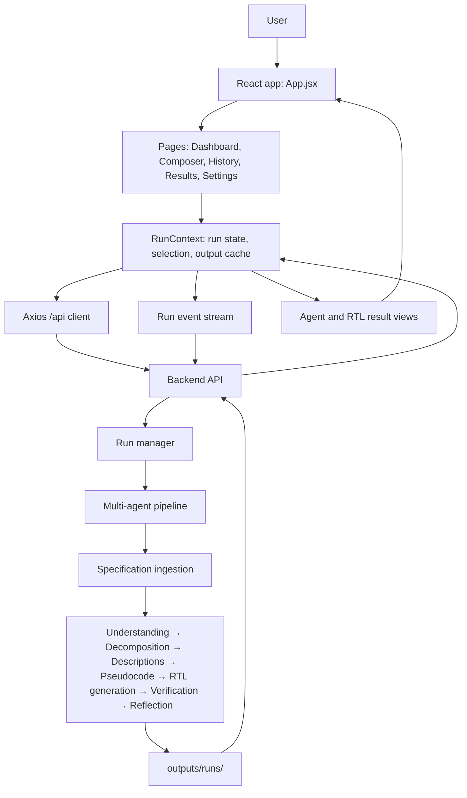

# SPEC2RTL Frontend

React and Vite interface for SPEC2RTL, a specification-to-RTL workflow. The frontend starts and monitors pipeline runs through the backend API, then presents each agent's artifacts, verification results, and generated RTL.

## Features

- Dashboard for run status and pipeline activity
- Upload a hardware specification to start a run
- Live progress through server-sent events, with polling fallback
- Run history and per-agent result views
- Generated pseudocode, RTL, verification details, and downloadable artifacts
- Composer and settings pages

## Architecture



The app uses React Router for page navigation. `RunProvider` owns run selection, starts uploads, fetches run metadata and artifacts, and subscribes to `/api/runs/{run_id}/events`. If the event stream fails, it polls the run endpoint every two seconds. Backend implementation and pipeline details live in the repository root alongside this frontend.

## Project layout

```text
src/
  App.jsx                 Application shell and routes
  api.js                  Shared Axios client and API error handling
  context/RunContext.jsx  Run lifecycle, event updates, and artifact loading
  pages/                  Dashboard, composer, history, results, settings
  views/                  Per-agent and RTL result panels
  components/             Navigation, upload, status, code, and data widgets
  lib/                    Formatting and syntax highlighting helpers
```

## Requirements

- Node.js with npm
- SPEC2RTL backend API available at `/api` (Vite development server proxies API requests to the backend)

## Development

```bash
npm install
npm run dev
```

Open the local URL printed by Vite. Configure the backend target in `vite.config.js` when needed.

## Production build

```bash
npm run build
npm run preview
```

The production bundle is generated in `dist/`.
